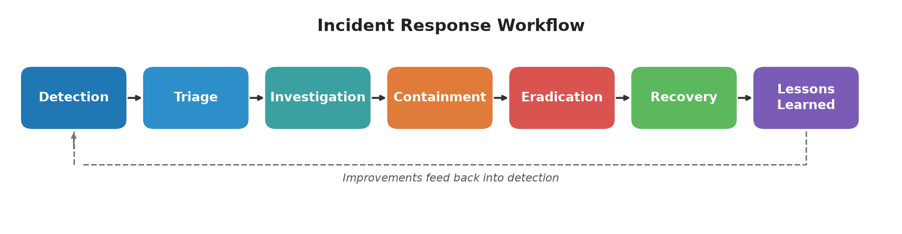

# SOC-Incident-Response-Playbook

A set of practical, original incident response playbooks for a Security Operations Center (SOC) analyst. Each playbook walks through the same seven phases so an analyst can pick up any alert type and know what to do next.



## How to Use
1. When an alert fires, pick the matching playbook from the index below.
2. Fill in the triage fields (host, user, IP, process, hash, severity, time) on the ticket first.
3. Work through the phases in order. Use the escalation table to decide when to bring in a senior analyst or leadership.
4. Track progress with the [incident response checklist](checklists/incident-response-checklist.md).
5. Close with lessons learned and feed new indicators back into detections.

## Index
| Playbook | Use when |
|---|---|
| [Phishing Response](playbooks/phishing-response.md) | Suspicious or reported email, credential harvesting |
| [Malware Response](playbooks/malware-response.md) | Endpoint alert, unknown process, persistence (includes a real applied example) |
| [Brute-Force Response](playbooks/brute-force-response.md) | Password guessing, spraying, credential stuffing |
| [Ransomware Response](playbooks/ransomware-response.md) | Encryption activity, ransom notes |
| [Suspicious Login Response](playbooks/suspicious-login-response.md) | Impossible travel, unknown device, MFA fatigue |
| [Incident Response Checklist](checklists/incident-response-checklist.md) | Every incident |

## Structure of Each Playbook
Detection, Triage (with standard fields), Investigation, Containment, Eradication, Recovery, Lessons Learned, Escalation Criteria, and MITRE ATT&CK mapping.

## Repository Layout
```
SOC-Incident-Response-Playbook/
├── README.md
├── playbooks/
├── checklists/
└── diagrams/
```

## References
These procedures are written from scratch. The following frameworks informed the overall phase structure and are listed as references only; no content is copied from them.
- CISA, *Federal Government Cybersecurity Incident and Vulnerability Response Playbooks*: https://www.cisa.gov/resources-tools/resources/federal-government-cybersecurity-incident-and-vulnerability-response-playbooks
- NIST SP 800-61, *Computer Security Incident Handling Guide*: https://csrc.nist.gov/pubs/sp/800/61/r3/final
- MITRE ATT&CK: https://attack.mitre.org/

## Author
John Danko, Cybersecurity Portfolio Project
